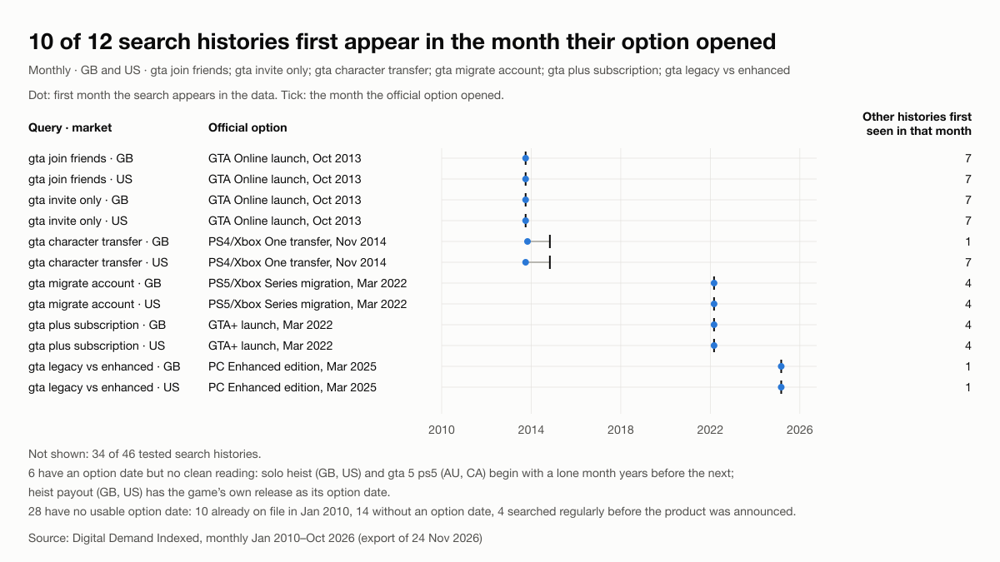
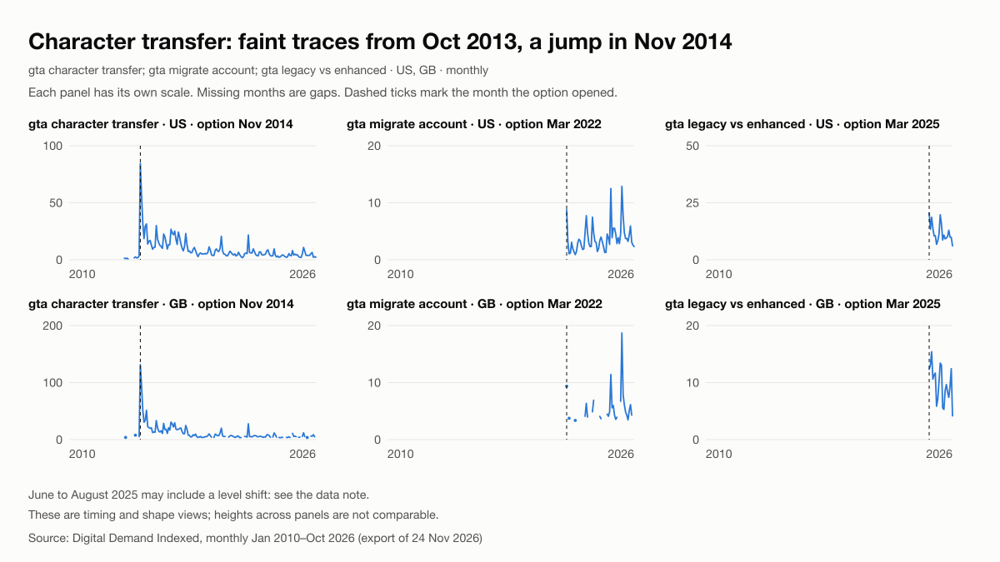
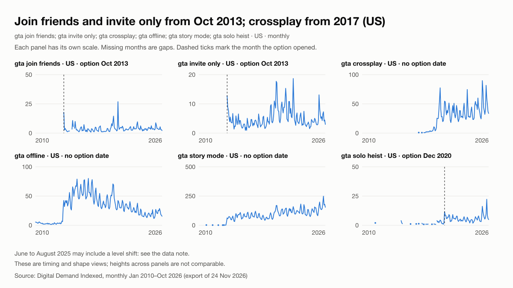

# Freedom has an entry cost: getting into GTA’s shared city

---

Before friends can play together in GTA, they have to settle which version, which account and which character.

## An invitation still needs a route

Picture an invitation to join friends in GTA. Before anyone meets, someone has to check that the versions match, that the account carries over and that the character is still there.

The question for the search record is narrower: when did these practical questions first show up in search, compared with the month the official option they concern opened? Digital Demand Indexed records search for a term in a given country; this post uses its monthly series from January 2010 to October 2026. On the charts, a tick marks the month an official option opened, and a dot marks the first month the search shows up in the data.

Search shows intent, not players, sales or causes.

## Carrying a character across versions

Rockstar’s documented options give continuity a concrete meaning. The November 2014 arrival on PlayStation 4 and Xbox One offered character transfer from the preceding consoles. March 2022 brought Online migration to PlayStation 5 and Xbox Series X|S. With Enhanced for PC in March 2025, the existing PC edition took the name Legacy.

The first chart shows six searches, each in Britain and the US: joining friends, invite-only access, character transfer, account migration, membership and Legacy versus Enhanced. Membership means GTA+, the subscription launched in March 2022. A history here is one search term in one country. These 12 histories are the only access questions, out of 46 search histories we looked at, with both a clear official date and a clean first month (a first month counts as clean unless the next reported month is years away). Of the other 34, 28 had no usable date or were searched before the product existed; 4 had a date but began with one lone month years before the next; and 2, the heist payout search, are not access questions, because their date is the game’s own release. So the chart shows how timing lines up where it can be checked, not how often it does.

*Source: Digital Demand Indexed.*

We picked the option dates after seeing when the searches first appeared, so this is a pattern spotted in hindsight, not a test. In every chart each search has its own scale, so a taller line does not mean more searches than a shorter one. Compare dates and shapes only. A gap in a line means the source reported nothing for that month; it does not mean zero.

In 10 of these 12 histories the search first shows up in the very month the option opened. Joining friends and invite-only access both appear in October 2013, the month GTA Online opened, in both countries. Account migration, membership and Legacy versus Enhanced appear alongside their options in March 2022 and March 2025. Britain’s membership search first appears as a single faint month in March 2022, followed by eight blank months, so that alignment is weaker than the others.

Character transfer is the exception. It first appears 12 months early in Britain (November 2013) and 13 months early in the US (October 2013), but only as faint, scattered months; in Britain the first is a single month followed by seven blank ones. The big jump comes in November 2014, the month the option opened, and then fades. The US start is also the month GTA Online opened, so the early months may not be about the console move at all. The data cannot say what those early searchers meant.

*Source: Digital Demand Indexed.*

A few reading notes. When a tick and a dot sit on top of each other, they fall in the same month. The right-hand column of the first chart counts how many other search histories, out of the 619 in the data set, also first show up in that month; the US October 2013 cluster is GTA Online’s opening month, and most of it is this post’s own searches. “First shows up” means first reported by the source, which only lists a search once it passes a minimum level. It does not mean nobody had searched for it before.

## Company is a separate access question

Joining friends, invite-only access and crossplay are different practical questions: reaching the same people, keeping a session closed, and connecting from different systems.

Crossplay’s first traces come years after the October 2013 searches: July 2017 in the US (shown on the third chart) and August 2017 in Britain. Britain’s trace is a single month, and a continuous history there begins in May 2019. Crossplay has no single official date in this comparison, so we cannot say whether it showed up early or late.

*Source: Digital Demand Indexed.*

The third chart’s other panels are shown for comparison and are not discussed here.

## What to ask about the new game

[Grand Theft Auto VI was released](https://www.take2games.com/ir/news/rockstar-games-announces-grand-theft-auto-vi-now-available) on 19 November 2026. The search record used here ends with October 2026, the last full month before the release, so it says nothing about the release itself or the weeks since.

What it does hold is what people searched for around earlier releases and updates. Can a character continue across a version change? Which edition is involved? How will friends reach one another? Those questions are worth asking about the new game too. The record cannot say what people are searching for now.

Among the twelve histories we could check, ten first show up in the month their option opened. That is a pattern seen in hindsight, in a hand-picked subset; why people searched is beyond what the data show.

---

**Data note.** In other Digital Demand series, search levels between June and August 2025 rose for some topics (telecom, sports) and not for others (fashion, professional networking). Whether this reflects the market or the measurement is not known, and gaming searches have not been tested. Treat any rise or fall in a line across that summer with caution. The first appearances discussed in this post all fall before June 2025.

*Source: Digital Demand Indexed, monthly, January 2010 to October 2026 (export of 24 November 2026).*
