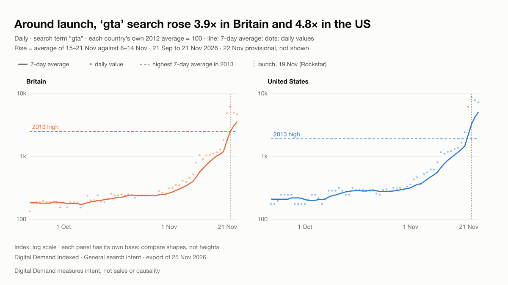
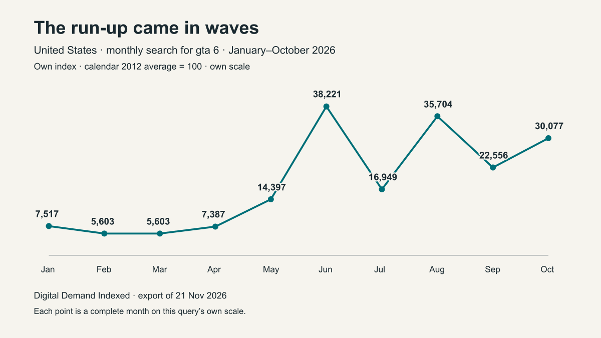
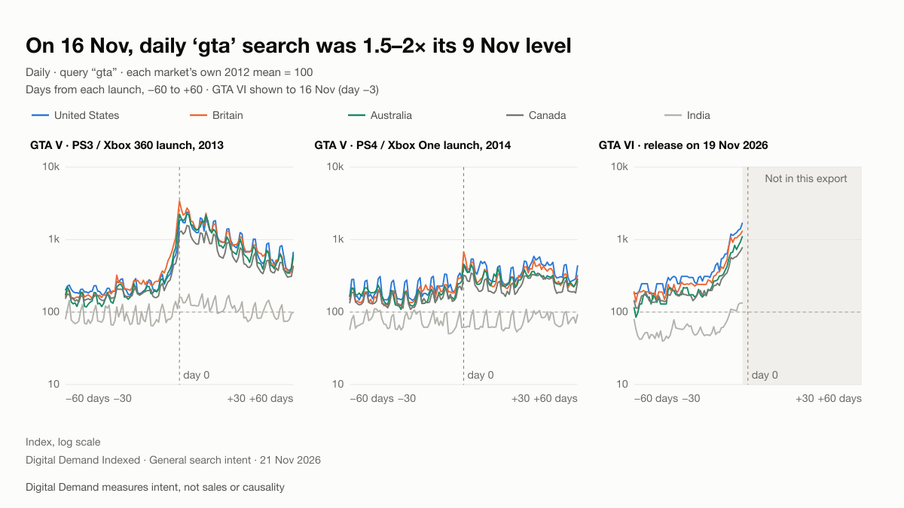
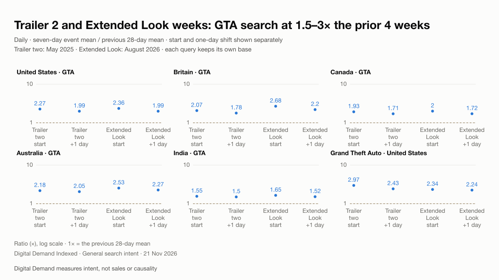

# GTA VI: the wait, the dates and the search surge through 21 November

---

*Daily search for “gta” rose sharply in Britain and the United States around GTA VI’s 19 November release. The latest observations run to 21 November, two days after release: they capture the immediate launch period, not a full week after it.*

[Rockstar’s release](https://www.take2games.com/ir/news/rockstar-games-announces-grand-theft-auto-vi-now-available) dated 19 November 2026 announced the game as “now available” on PlayStation 5 and Xbox Series X|S. The wait had included a public confirmation of development, two trailers whose first-day views were reported as records, and a release date that moved twice.

A day later, [a Rockstar release on Take-Two’s investor site](https://ir.take2games.com/news-releases/news-release-details/grand-theft-auto-vi-shatters-entertainment-box-office-records) put day-one retail sales at $3.79 billion, by company estimates, worldwide, through 19 November. That is the company’s own sales estimate; the search figures below are a separate measure and say nothing about it.

> **Reporting windows.** The latest daily search observations in this post end on 21 November 2026. The other charts use earlier windows: the monthly series ends in October, the GTA VI pre-release comparison ends on 16 November, and the trailer chart uses windows around each event. Export dates say when the data were extracted, not how recent the observations are. Ratios and averages are Digital Demand calculations; sales, views, dates and forecasts are reported by the named sources.

## The immediate launch period, through 21 November

A daily export extracted on 25 November extends the search term “gta” through 21 November 2026. The chart shows 7-day averages (each day averaged with the six before it) for Britain and the United States, each measured against that country’s own 2012 level, with the 19 November release marked.

The 7-day average for 15–21 November was 3.9 times the average for 8–14 November in Britain and 4.8 times in the United States. That later week has four days before release and three from release day on, and the daily values had already jumped on 18 November, the day before release, so the rise is not a release-day effect alone.

In both countries the daily value peaked on 19 November and was lower on the two days after. The 7-day average kept rising because each new day from 18 November replaced a much quieter day from the week before. Single days are revised in later exports, so treat the peak day as approximate and rely on the 7-day line.

*Source: Digital Demand Indexed. Search term: “gta”; countries: Britain and United States; days shown: 21 September–21 November 2026; exported: 25 November 2026. Lines show trailing 7-day averages, dots daily values. The 22 November value, the last in the export and still likely to be revised, is left out.* The index sets each country’s 2012 average to 100, so 1,000 means ten times that average; the vertical axis steps by factors of ten, so equal distances mean equal multiples. Each panel is measured against its own country’s 2012 level, so compare the shapes, not the heights. The dashed line is the country’s highest 7-day average of 2013, the year GTA V was released.

By 21 November the 7-day average had passed that 2013 high in both countries: about 1.4 times it in Britain and about 2.7 times it in the United States. That comparison spans thirteen years and crosses summer 2025 (see the data note at the end), so read it as an indication of scale, not as a like-for-like record.

“gta” is a broad search term: it also catches people looking up GTA V or the series, so it cannot isolate searches about GTA VI. And Digital Demand Indexed measures search intent, what people looked for, not why they looked, how many bought the game or how many play it.

## How the run-up looked

Before release, the exact phrase *gta 6* is the narrower measure. The monthly United States series for that phrase runs from January through October 2026, so it describes the run-up, not November’s launch period. It covers the exact phrase only and leaves out other spellings, such as *gta vi*.

Searches for *gta 6* rose to a first peak in June and a second in August, with dips between. The data do not say what caused either wave.

*Source: Digital Demand Indexed. Search term: “gta 6”; country: United States; months shown: January–October 2026; exported: 21 November 2026.* The index sets this phrase’s 2012 average to 100. Searches for *gta 6* were rare in 2012, so the figures are very large and are not numbers of searches: read the shape across months, not the height. *gta 6* and “gta” are separate series on separate bases, so their levels cannot be joined into one line.

A second daily chart lines up “gta” around each release: GTA V’s two console releases and the run-up to GTA VI. Its GTA VI panel comes from the 21 November export, which stops on 16 November, three days before release, so it shows the pre-release period only. On that day the daily value was about double the 9 November value in the United States (2.02 times) and in Australia (2.00), and between 1.50 and 1.84 times in India, Britain and Canada. These are single days, which later exports revise, so read them as approximate.

*Source: Digital Demand Indexed. Search term: “gta”; countries: United States, Britain, Australia, Canada and India; days shown: 60 days either side of GTA V’s releases (to 16 November 2013 and 17 January 2015) and GTA VI to 16 November 2026; exported: 21 November 2026.* The middle panel is GTA V’s 2014 release on PS4 and Xbox One. The shaded area means “not in this export”, not zero. Each line is on its own country’s scale, so compare shapes, not heights; setting 2026 beside 2013 and 2014 crosses summer 2025 (see the data note at the end).

## From a year to a day: the release date

- **February 2022:** Rockstar confirmed it was working on the game, as [BBC News reported](https://www.bbc.com/news/entertainment-arts-67356079) on 8 November 2023.
- **4 December 2023:** the [first trailer](https://www.rockstargames.com/VI/trailer-1), with [a 2025 window](https://www.take2games.com/ir/news/rockstar-games-announces-grand-theft-auto-vi-coming-2025).
- **2 May 2025:** in a [Take-Two release](https://www.take2games.com/ir/news/take-two-interactive-software-inc-reiterates-expectations), Rockstar announced that the game, expected in autumn 2025, was now planned for 26 May 2026.
- **Later in 2025:** [Rockstar moved it again](https://www.rockstargames.com/newswire/article/ak3ak31a49a221/grand-theft-auto-vi-is-now-set-to-launch-november-19-2026), to 19 November 2026.
- **19 November 2026:** release.

## Trailers: views and search measure different things

In its [report of 8 May 2025](https://www.ign.com/articles/gta-6-trailer-2-the-biggest-video-launch-of-all-time-rockstar-says), IGN described the first trailer’s 93 million first-day views as a YouTube launch record outside music. The same article relayed Rockstar’s statement to The Hollywood Reporter that the second trailer, released that May, reached 475 million views across platforms during its first day. Those records count views of particular videos, with different platform coverage; they cannot show how many individual people watched.

Search gives a different kind of signal: how strongly people looked for the topic, compared with the same country’s recent past. In the 7 days from trailer two’s release, search for “gta” averaged 2.27 times the previous 28 days in the United States and 2.07 times in Britain. A second window starts on 27 August 2026, the date [Rockstar’s video page](https://www.rockstargames.com/VI/trailer-1) gives for an “Extended Look” video; it shows ratios of 2.36 in the United States and 2.68 in Britain.

*Source: Digital Demand Indexed. Search terms: “gta” (United States, Britain, Canada, Australia, India) and “Grand Theft Auto” (United States, final panel); days shown: seven-day windows from 6 May 2025 (trailer two) and 27 August 2026 (labelled “Extended Look”), each against the previous 28 days; exported: 21 November 2026.* “Start” is the seven days from the event date; “+1 day” is the seven days from the following day. Each search term keeps its own base.

## What search can and cannot tell us

When the 2026 date was announced in May 2025, [Take-Two said](https://www.take2games.com/ir/news/take-two-interactive-software-inc-reiterates-expectations) it still expected record levels of net bookings in fiscal 2026 and 2027. Those were company-wide expectations, not GTA VI takings. The same day, [GamesRadar reported](https://www.gamesradar.com/games/grand-theft-auto/i-dont-think-anyone-benefits-in-2025-from-this-gta-6-delay-is-bad-news-for-the-games-industry-analyst-says-adding-to-nightmare-scenario-territory-following-xbox-price-hike/) Circana analyst Mat Piscatella’s view that “I don’t think anyone benefits in 2025” from the delay, because the game “would bring relapsed players back to the consoles”.

Not every move was linked to GTA VI by those making it. When Borderlands 4 moved from 23 to 12 September 2025, [Gearbox head Randy Pitchford said](https://www.gamesradar.com/games/borderlands/gta-6-has-nothing-to-do-with-borderlands-4s-new-release-date-as-gearbox-ceo-insists-its-100-percent-the-result-of-confidence-not-any-other-products-actual-or-theoretical-launch-date/) the decision was “literally 0% about any other product’s actual or theoretical launch date”.

Search sits beside these accounts without settling them. It shows how sharply searches for “gta” rose around the release, measured against each country’s own past. It does not show sales, players or the reasons people searched.

---

**Data note.** In other Digital Demand series, search levels around June to August 2025 rose for some topics (telecoms, sports) and not for others (fashion). Whether this reflects the market or the measurement is not known, and gaming searches have not been tested. Comparisons that cross that summer, such as 2026 against 2013, show scale only.
