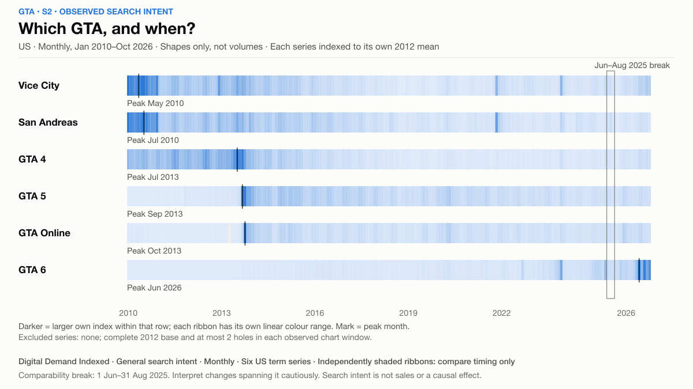
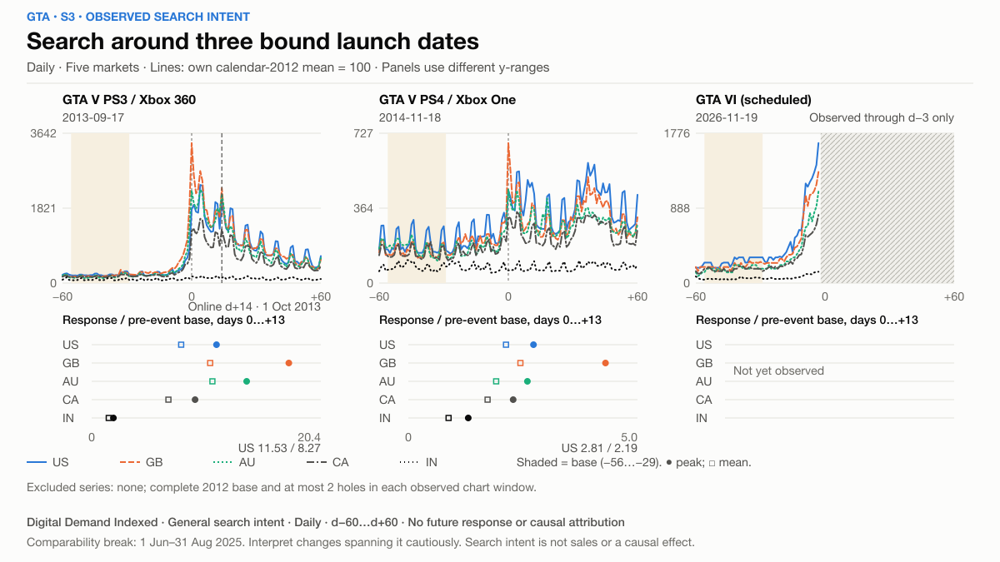
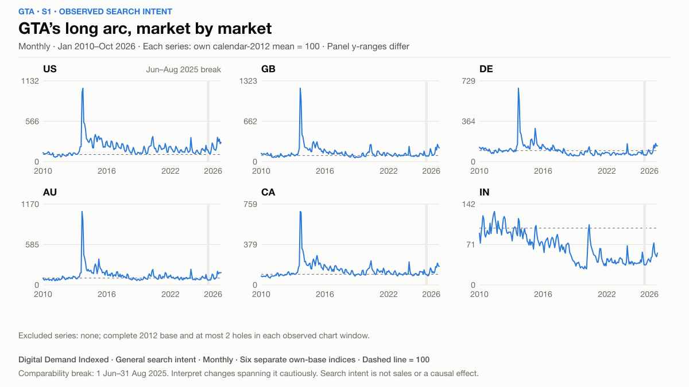
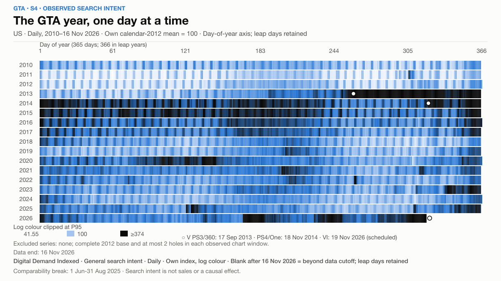
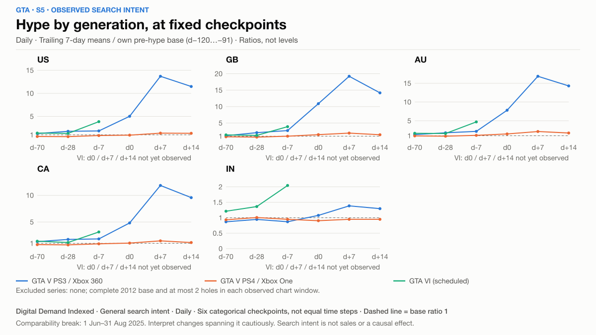

# The city that kept coming back: a short history of Grand Theft Auto, told twice

---

Grand Theft Auto is usually told as a story of bigger maps. This post tells it as a story of a city that players enter, use and keep returning to, and checks the last fifteen years of that story against something players leave behind: what they search for.

Two kinds of evidence sit side by side here. The history comes from publisher releases, court and parliamentary records and named interviews. The search curves come from Digital Demand Indexed, monthly from 2010 and daily for five markets. Search shows intent, not sales or players, and every curve is drawn against its own 2012 average, so the shapes can be compared but the heights cannot.

## 1. Before realism, freedom

The game began as *Race'n'Chase*, in a design document dated 25 January 1995 by K. R. Hamilton at DMA Design in Scotland. An early prototype was side-on; adding a floor turned it into the top-down view the first game shipped with.

The game made noise before it made money. In May 1997 a question in the House of Lords asked whether the government would act on its "reported release for sale later this year". By December the British Board of Film Classification had given it an 18 certificate. The publisher then used the controversy itself, in a radio campaign built from excerpts of the Lords debate.

Two London expansions followed in 1999, *London 1969* on 30 April and *London 1961* on 1 July. Rockstar Games had been founded in December 1998 as a publishing label inside Take-Two. DMA Design itself was renamed Rockstar Studios in 2002 and became Rockstar North that May.

*No search data exists for these years; our series start in 2010.*

## 2. Into the city in three dimensions

*Grand Theft Auto III* shipped to North American stores on Monday 22 October 2001, as a PlayStation 2 exclusive. Its technical trick was simple to state: "the game was just streaming geometry and textures from the disc". The city no longer had to fit in memory at once; it arrived as you drove into it.

## 3. Place as a design resource

*San Andreas* reached US stores on 26 October 2004, built by Rockstar North on the same RenderWare technology. Handheld spin-offs carried the cities to new devices: *Liberty City Stories* on PSP in October 2005 and *Chinatown Wars* on Nintendo DS.

*San Andreas* also brought the series its hardest regulatory moment. After the hidden "Hot Coffee" content was exposed, the ESRB announced the "immediate revocation of the game's M (Mature 17+) rating", and the US Federal Trade Commission later approved a final consent order against Take-Two and Rockstar. Outside the US, BBC News reported in 1998 that Brazil's justice ministry had ordered all copies of a game called *Grand Theft Auto* removed from shops, and Thai police said they had officially banned a GTA game.

Search remembers these games too, but only from 2010. In the US, interest in *Vice City* and *San Andreas* was highest in the first months of our window and then settled (chart S2). Both are still searched: from January to October 2026, US search for *Vice City* ran 1.51 times its level a year earlier, and *San Andreas* 1.13 times.

*Source: Digital Demand Indexed.*

## 4. Two kinds of realism

*Grand Theft Auto IV* arrived on PlayStation 3 and Xbox 360 on 29 April 2008. It ran on Rockstar's own engine, RAGE, with NaturalMotion's Euphoria animating bodies: "It is actually all synthesized on the CPU. Which means that it has a completely different outcome every time you play". Episodes followed as downloads, first as Xbox 360 exclusives.

*Grand Theft Auto V* kept Euphoria and launched on PlayStation 3 and Xbox 360 on 17 September 2013. This is where search can finally speak.

**Chart S3** shows daily search around three dated launches. For the 2013 launch, the highest day in the first two weeks reached 11.5 times the pre-launch base in the US, 18.2 in Britain, 14.3 in Australia and 9.6 in Canada; India moved far less, at 2.0. When the same game was re-released on PlayStation 4 and Xbox One on 18 November 2014, the jump was much smaller: 2.8 in the US, 4.4 in Britain. A new platform release is not a new game.

*Source: Digital Demand Indexed.*

**Chart S1** shows the longer arc. In every Western market, monthly search peaked in September or October 2013. The peak alone is not the story. What matters is that it did not return to where it had been. US search in 2013 averaged 3.49 times its 2012 level; in 2014 it eased only to 0.87 times the 2013 level. Across the US, Britain, Australia and Canada, the curves stay above their 2012 line for years (S1). India is the exception: its search peaked in June 2011 and has mostly run below its 2012 level since.

*Source: Digital Demand Indexed.*

**Chart S4** puts every US day since 2010 on one page. From late 2013, the rows turn dark, and they stay dark for several years.

*Source: Digital Demand Indexed.*

## 5. The city becomes a service

*Grand Theft Auto Online* launched on 1 October 2013, two weeks after the game, and came "free with every copy of Grand Theft Auto V". A PC version followed, bringing the Rockstar Editor with it.

That is the reading this post proposes for the raised floor in S1: players kept coming back because there was a continuing city to come back to. The data is consistent with that reading; it does not prove it. Search cannot say why people searched.

Players built their own cities too. Multiplayer modifications predate Online: *MTA* for *Vice City*, and *SA-MP*, whose "first playable release was launched in May 2006". For *GTA V*, *FiveM* "has existed in various forms since 2014" and *RAGE Multiplayer* "started in May 2016". The relationship with the publisher was uneasy: one team received an official cease-and-desist letter, and Take-Two filed a DMCA notice against the *re3* and *reVC* reverse-engineering projects. Later a GTA V roleplay modding team became "officially a part of Rockstar Games".

The city also became something to watch. On 2 May 2021, *GTA V* drew 1,141,000 concurrent viewers on Twitch, and in 2021 it gathered 2.1 billion hours watched.

## 6. One city, many markets

India's curve is different, and the sources suggest why the timing differs. An India Today feature argued that "the true democratisation of the franchise happened on the PC". Local creators made the game visible: one Techno Gamerz *GTA 5* video recorded more than 13 million views. Rockstar also builds there, with a Bengaluru team that contributed to *GTA V*. These are hypotheses for India's shape, not explanations the data can confirm.

## 7. The bridge to VI

Rockstar's record is not unbroken. Of its remastered trilogy of III, Vice City and San Andreas, Rockstar wrote that it "did not launch in a state that meets our own standards of quality, or the standards our fans have come to expect".

*Grand Theft Auto VI* was first expected in fall 2025, then moved to 26 May 2026, and was scheduled to launch on 19 November 2026. Our data stops three days before.

**Chart S5** measures the build-up the same way for each generation: search at fixed points before and after launch, against its own level about four months earlier. One week before launch, *GTA VI* stood at 3.9 times its base in the US, 3.9 in Britain, 4.7 in Australia, 3.1 in Canada and 2.0 in India. At the same point in 2013, *GTA V* stood at 1.8, 2.7, 2.2, 1.8 and 0.9. In every market, the wait for VI has built higher than the wait for V. In India, where V barely moved search, VI has doubled it. In the US, Jan-Oct 2026 search for "gta 6" ran 2.87 times its level a year earlier.

*Source: Digital Demand Indexed.*

What happens after launch day is not yet observed. That is the next post.

---

**How to read the charts.** Each line is its own index: 100 is that series' own average in 2012, one fixed base for all years. Panels have different scales, so compare shapes, not heights. In S3 the dots are the peak (●) and mean (□) of the first two weeks after launch, divided by the base; "US 11.53 / 8.27" means peak 11.53, mean 8.27. S4 uses a log colour scale; the darkest colour covers the top 5% of days. S5's checkpoints are not evenly spaced in time. Search intent is not sales, players or cause.

Text figures and chart S3 use the 20 Nov 2026 export; charts S1, S2, S4 and S5 use the 19 Nov 2026 export. At the printed precision, the two exports differ only in these three figures.

**Footnote (break).** Between June and August 2025 the source shows a level shift; comparisons across that period, including all 2026-vs-2025 ratios above, should be read with caution.

*Source: Digital Demand Indexed, general search intent, monthly Jan 2010-Oct 2026 and daily to 16 Nov 2026.*

---
